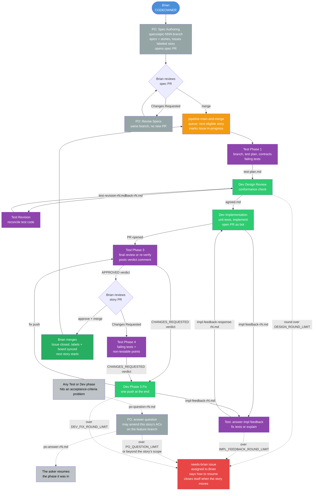

# Agentic Workflow: Automation Reference

This document shows the complete automated workflow: which event hands work to which persona, the loops personas settle on their own, where Brian comes in, and why it is built this way.

Actor, account and command names below are the reference project's values (`birdman74`, `briankcampbell-streamvault-bot`, `claude-streamvault-*`, `mvn clean verify`). In your project they all come from `.github/pipeline-config.env`; see [new-project-setup.md](new-project-setup.md).

---

## How the Pipeline Is Built

```
GitHub event ──> pipeline-*.yml adapter ──> gate job (GitHub-hosted runner)
                                               │  checks out main
                                               │  scripts/transition.sh route <event>
                                               │    which hand-off? still needed? round limit?
                                               ▼
                                 persona-run.yml@main (self-hosted runner)
                                   recheck ─> record ─> launch persona ─> remove container
                                   ─> verify result on GitHub ─> escalate, or resolve old escalations
```

| Piece | Role |
|---|---|
| `.github/pipeline-config.env` | Every knob: accounts, persona git authors, launcher paths, round limits, timeouts, retries, board names |
| `scripts/pipeline-config.sh` | Parses and validates the config (never executes it) |
| `scripts/transition.sh` | The single registry of hand-offs: routing, live state checks, rounds, limits, prompts, expected outcomes, "how to resume" text |
| `.github/workflows/persona-run.yml` | Reusable: runs one persona for one hand-off, verifies, escalates, cleans up |
| `.github/workflows/pipeline-*.yml` | Six thin event adapters |
| `scripts/persona-outcome-check.sh` | Low-level GitHub checks used by verify |
| `scripts/escalate-to-brian.sh` | Opens, updates and auto-closes `needs-brian` issues |

Everything except the adapters' event wiring runs from `main`, for every story, whatever branch it is on.

---

## Workflow Diagram



Dotted lines are the exceptions: a question to PO, which any Test or Dev phase can ask (the answer wakes whoever asked, in the phase it was in), and escalations. Every persona run, solid or dotted, is also verified, and a missing result escalates (see [Escalation](#escalation)).

---

## Hand-off Table

All design files live in `docs/specs/design/` on the story's feature branch. Limits are keys in `.github/pipeline-config.env`.

| Transition | Adapter (event) | Fires when | Wakes | Expected result | Limit |
|---|---|---|---|---|---|
| `test-kickoff` | `pipeline-main-and-merge` (story spec pushed to main, story PR merged) | the queue has an eligible story | Test Phase 1 | branch with `test-plan.md` and `api-contracts.md`, or a PO question | |
| `dev-design-review` | `pipeline-feature-push` | Test pushed `test-plan.md` or `test-revision-rN.md` | Dev design review | `agreed.md`, `dev-feedback-rN.md`, or a PO question | `DESIGN_ROUND_LIMIT` |
| `test-design-revision` | `pipeline-feature-push` | Dev pushed `dev-feedback-rN.md` | Test revision | `test-revision-rN.md`, or a PO question | |
| `dev-implement` | `pipeline-feature-push` | Dev pushed `agreed.md`, or Test pushed `impl-feedback-response-rN.md` | Dev Phase 2 (or Phase 3 if a PR is open) | open PR, or `impl-feedback-rN.md`, or a PO question | |
| `test-impl-feedback` | `pipeline-feature-push` | Dev pushed `impl-feedback-rN.md` | Test | `impl-feedback-response-rN.md` with fixed tests, or a PO question | `IMPL_FEEDBACK_ROUND_LIMIT` |
| `test-final-review` | `pipeline-pr-opened` | the bot opened or reopened a story PR | Test Phase 3 | a verdict comment | |
| `test-reverify` | `pipeline-feature-push` | Dev pushed after Test's latest CHANGES_REQUESTED verdict | Test Phase 3 | a verdict comment | |
| `dev-fix` | `pipeline-test-verdict` | Test posted a CHANGES_REQUESTED verdict | Dev Phase 3 | a new Dev commit | `DEV_FIX_ROUND_LIMIT` |
| `test-brian-review` | `pipeline-review-submitted` | Brian requested changes on a story PR | Test Phase 4 | a CHANGES_REQUESTED verdict | |
| `po-spec-revision` | `pipeline-review-submitted` | Brian requested changes on a specs PR | PO | a new PO commit | |
| `po-clarify` | `pipeline-feature-push` | Test or Dev pushed `po-question-rN.md` | PO | `po-answer-rN.md` | `PO_QUESTION_LIMIT` |
| `resume-after-po` | `pipeline-feature-push` | PO pushed `po-answer-rN.md` | whoever asked | a new commit (or, for Test, a verdict) | |

`pipeline-manual` (Actions, "Pipeline - Manual Dispatch") runs any transition by hand.

---

## Brian's PR Review Guide

### When to review

Review a story PR only after Test's **latest** verdict comment on it is `APPROVED` (the comment starts with the hidden marker `<!-- test-verdict: APPROVED -->`; GitHub shows the Test Run Summary). If the latest verdict is `CHANGES_REQUESTED`, Dev is already working on it: wait.

### What to check

1. The **Spec Changes** section of Test's verdict. Any acceptance criterion PO amended during the story is listed there. Read each one: PO may only settle things within the story's scope.
2. **Acceptance Criteria Coverage** and **Regression Analysis** in the verdict.
3. The diff itself, against `CONTRIBUTING.md` and the ADRs.

### Approve and merge

1. Approve the PR, then merge it.
2. Nothing else: the pipeline closes the story Issue as completed, removes `in-progress`, unblocks dependent stories, moves the board, and starts the next eligible story.

### Request changes

1. Submit a review with **Request changes**. Put each point in its own line comment or bullet, so Test can map it to one test.
2. Point out anything that is not testable (naming, structure, comments, docs) as plainly as anything else: Test lists those as Non-testable review points for Dev instead of inventing tests.
3. Wait. Test writes failing tests, posts a CHANGES_REQUESTED verdict, Dev fixes, Test re-verifies. Your review resets the Dev fix round count, so this round never escalates straight back to you.

### When a `needs-brian` issue arrives

It is assigned to you and emails you. It names the story, the stage, what went wrong, the persona's last output (any question it asked is at the end), and a **How to resume** line.

1. Fix the cause: answer the question, settle the design, fix a test, or raise a limit in `.github/pipeline-config.env` if the loop was making real progress.
2. Restart the pipeline exactly as the How to resume line says, usually **Actions > Pipeline - Manual Dispatch** with the transition and inputs it names. A commit by you on a feature branch never launches a persona by itself.
3. The issue closes itself when the next persona run for that story succeeds. Close it by hand only if you resolved it another way.

| Stage in the issue title | Usual cause | Usual fix |
|---|---|---|
| `design round limit reached` | Test and Dev cannot agree | commit `story-NNN-agreed.md` yourself, then Manual Dispatch `dev-implement` |
| `implementation feedback limit reached` | Dev and Test disagree about tests | settle the tests, then Manual Dispatch `dev-implement` |
| `PO question limit reached` | the story is underspecified | answer in `po-answer-rN.md`, then Manual Dispatch `resume-after-po`, or rework the story |
| `PO clarification needs Brian or stalled` | PO judged the answer beyond the story's scope | decide, write the answer, then Manual Dispatch `resume-after-po` |
| `Dev fix round limit reached` | Test and Dev are not converging on a PR | review the PR (resets the count) or Manual Dispatch `dev-fix` |
| `story PR closed without merge` | the PR was closed | reopen it, or abandon the story as the issue describes |
| `... stalled` | a persona crashed, timed out, or stopped with NEEDS BRIAN | read the output, fix, Manual Dispatch the named transition |

---

## Why It Works This Way

**One registry, thin adapters (ADR-005).** Every rule about a hand-off lives in `scripts/transition.sh`, and the launch, verify and escalate steps live once in `persona-run.yml`. Fixes are made once, every rule is mock-tested, and because the gate checks out `main` and calls `persona-run.yml@main`, a fix reaches in-flight stories immediately instead of waiting for `main` to be merged into their branches.

**One config file.** Every limit, timeout and account name is in `.github/pipeline-config.env`, versioned and reviewed like code. Persona instructions name the limits instead of repeating numbers.

**One push, at most one hand-off.** A push is routed by its head commit's persona and the hand-off file it brought in, in a fixed priority order, so it can never wake two personas. Test's first look at a PR always comes from the final review; a Dev push wakes Test again only after a CHANGES_REQUESTED verdict.

**Live state, checked twice.** The gate reads the live branch, PR and comments from the API, never the triggering commit's tree, and `persona-run.yml` checks again just before launch. A run that waited hours behind another persona on the single self-hosted runner is skipped if its work was done meanwhile.

**Personas settle their own disagreements.** Design feedback, defective tests and acceptance-criteria questions go straight from one persona to another. Brian is pulled in only when a loop passes its limit, which usually means something a persona cannot fix (an underspecified story, a real design dispute).

**PO answers on the feature branch.** In-scope acceptance-criteria changes travel with the story PR, the standard docs-as-code practice, and Test's verdict lists them so Brian sees every one. Anything beyond the story still goes to Brian.

**Outcome verification, not exit codes (ADR-003).** A persona that asks a question, crashes, or times out still looks like a finished process. Every run checks the expected artifact on GitHub and escalates when it is missing.

**Verdict comments, not reviews (ADR-004).** Dev and Test share the bot account that opens the PR, and GitHub does not let a PR author review its own PR. Test's verdict is a PR comment with a machine-readable marker, and it is the only trigger for Dev fixes.

**Guards against GitHub's own quirks (ADR-002).** `paths:` filters are unreliable on force-pushes, so the gate computes the pushed files itself and checks the commit author. A force-push that only reorders commits launches nothing.

---

## Story Queue Manager

Stories are GitHub Issues labeled `story`. The queue (`scripts/next-story.sh`, run by the `test-kickoff` gate) starts the lowest-numbered open story whose prerequisites (the `## Prerequisites` section of its spec) were all closed as **completed**, and only when no story is `in-progress`. A story closed as not planned keeps its dependents blocked.

When a story PR merges, the gate removes `in-progress`, closes the Issue as completed, waits `API_PROPAGATION_WAIT_SECONDS` for the API to reflect it, and starts the next story. `sync-blocked-labels.yml` keeps `blocked` labels in step with prerequisites, and `sync-project-board.yml` moves each story to Done, In Progress, Backlog (blocked) or Ready from its live state.

---

## Escalation

Every escalation is a `needs-brian` issue created by the bot account and assigned to Brian (`ESCALATION_ASSIGNEE`), so GitHub notifies him. One issue per story and stage: a repeat adds a comment. See the review guide above for what each stage means and how to resume.

---

## Manual Override

**Actions > Pipeline - Manual Dispatch** runs any transition with a story ID (and optionally branch, PR number, round, and mode). Manual runs skip the author, state and round-limit checks, because Brian is overriding them, but the persona's result is still verified and escalated.

---

*This document lives in `ai-dev-toolkit` because it documents the reusable workflow framework.*
